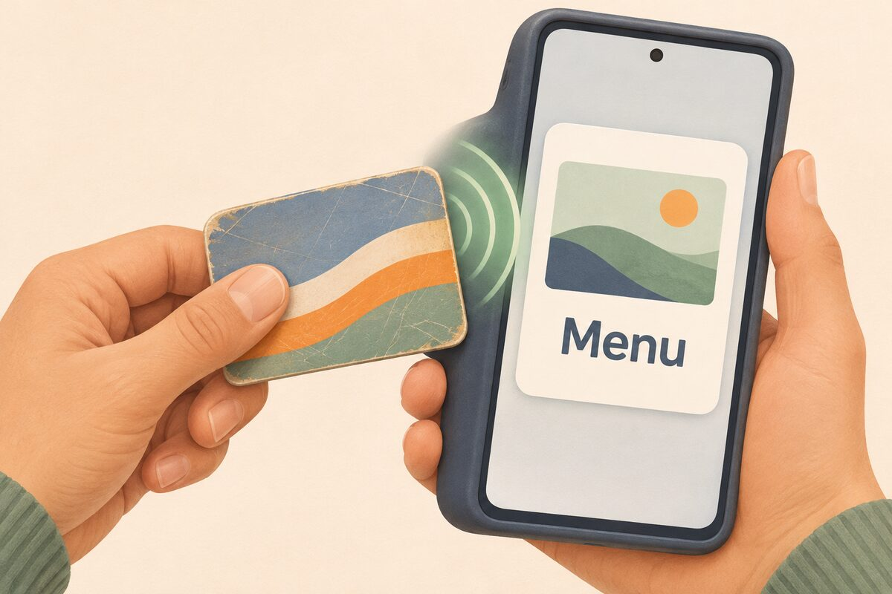
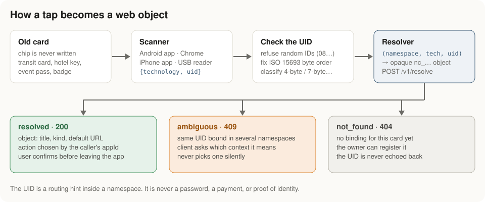

# NewCard 🪪♻️

**Old card. New identity.**



**NewCard** is an independent, open-source project for giving compatible, existing NFC cards useful new purposes **without writing to the card**. **ncNFC** is the draft, application-agnostic recognition and resolution protocol behind it.

A card's readable radio identifier is an *observation*, not a URL, login credential, or guaranteed globally unique identity. ncNFC translates that observation, plus an explicit namespace when necessary, into a stable web object. One object may expose different actions to different integrated applications.

> **Status: proof of concept / draft ncNFC 0.1.** This repository contains a working Node.js resolver, local registration CLI, JavaScript client, schemas, and tests. It does **not** yet contain an Android/iOS scanning app, secure account ownership, or a public hosted registry.

## How it works



| Read next | |
| --- | --- |
| [How it works](docs/HOW-IT-WORKS.md) | End-to-end flow, scanning paths per platform, UID quality, trust tiers, ncNFC 0.2 proposals |
| [Landscape](docs/LANDSCAPE.md) | Which cards and phones expose usable IDs, prior art, legal and privacy |
| [Fact ledger](docs/FACTS.md) | Every technical claim with its status and source |
| [Roadmap](docs/ROADMAP.md) | Implementation phases with "done when" checks |

## Why?

An expired transit card or decommissioned access badge may still expose a stable NFC identifier. Why purchase a new writable NFC tag for a restaurant menu, business card, inventory label, or pet profile if an existing compatible card can act as a lookup key?

```text
Physical card (unchanged)
  -> compatible phone + NewCard scanner / integrated NFC reader
  -> ncNFC observation { technology, uid }
  -> registry translation { namespace, technology, uid } -> nc_... object
  -> app-specific action or public web profile
```

A card not already configured with a readable NDEF URL **will not spontaneously open a website** when tapped with a stock phone. In this phase, a NewCard-compatible scanner is needed. The same UID may also occur on multiple cards, and some cards use random UIDs; the resolver explicitly represents collisions rather than pretending every card is unique.

## Try it in 60 seconds

Requirements: **Node.js 20+**, no production dependencies.

```bash
npm test
npm run demo
```

`npm run demo` seeds **fictional**, synthetic test cards in a JSON file and starts an HTTP resolver at `http://127.0.0.1:8787`.

In another shell:

```bash
curl -s http://127.0.0.1:8787/.well-known/ncnfc
curl -s -X POST http://127.0.0.1:8787/v1/resolve \
  -H 'Content-Type: application/json' \
  -d '{"technology":"iso14443a","uid":"04:A2:7F:91","namespace":"demo.restaurant","appId":"com.example.ordering"}'
```

The resolution result points to a public, app-independent `nc_...` object, with a contextual destination. To register your own **synthetic or permitted card observation**:

```bash
npm run register -- --namespace demo.mine --technology iso14443a \
  --uid 04:DE:AD:BE --title 'My test card' \
  --url https://example.com --kind link
```

Run the resolver without seeding:

```bash
npm start
```

To inspect manually, the demo CLI supports `npm run lookup -- --technology iso14443a --uid 04DEADBE --namespace demo.mine`.

Data defaults to `./data/registry.json` (gitignored); override with `NEWCARD_DATA_FILE`. The server is **read-only**: card registration happens through the local CLI, not an unauthenticated public endpoint.

## Repo layout

| Path | Purpose |
| --- | --- |
| `spec/ncnfc-0.1.md` | Draft protocol, namespace + collision rules, resolver contract |
| `spec/schemas/` | JSON Schema for observation and resolution |
| `src/` | Reference registry, translation and HTTP resolver |
| `bin/newcard.js` | Local registration/lookup/serve CLI |
| `sdk/js/` | Zero-dependency JavaScript resolver client; does not scan NFC hardware |
| `docs/` | Security, compatibility, roadmap, and integration notes |
| `docs/FACTS.md` | Fact ledger: each claim, its status (doc / source / field / untested), and source |
| `docs/images/` | Diagrams (SVG) and illustrations |
| `docs/LANDSCAPE.md` | Which cards, phones and browsers expose usable IDs; prior art; sources |
| `docs/HOW-IT-WORKS.md` | End-to-end flows, scanning paths, quality classes, assurance tiers, 0.2 proposals |
| `src/observation.js` | UID quality classifier and canonical byte order |
| `tools/webnfc-probe.html` | Android Chrome page to test which of your cards Web NFC can see |
| `examples/` | Synthetic sample objects |

## Central idea: CGNAT-inspired NFC addressing

A UID is similar to a private/shared address: *not sufficient by itself* to address a global object. ncNFC uses a tuple of `(technology, normalized UID, namespace)` to translate to a logical object ID. Application context then selects an action. When multiple candidates remain, the resolver returns **ambiguous**, never an arbitrary match.

This borrows the **namespace/translation idea** from CGNAT, not CGNAT's actual port mapping, connection state, or identity assurances. If two physically distinct cards expose exactly the same observable fingerprint **in the same namespace**, no registry can magically differentiate them. They must be treated as an unresolved collision or need additional trustworthy distinguishing data.

## Design commitments

- **No card modifications**: the original chip contents stay intact.
- **No mandatory hardware purchases**: reuse works only for cards you already own or are authorized to repurpose, subject to device compatibility.
- **Open protocol**: third-party apps can resolve objects with HTTP/JSON; the future NewCard app provides scanning and claiming UX.
- **No UID-as-authentication**: card identifiers are public observations, sometimes clonable; never use them to grant access or authorize purchases.
- **Privacy first**: never expose raw UID in public object pages; don't build a passive person-tracking system.
- **Context without lock-in**: a card can offer a default destination and app-specific destinations without knowing any applications itself.

## Contribute

See [`CONTRIBUTING.md`](CONTRIBUTING.md), [`docs/ROADMAP.md`](docs/ROADMAP.md), and the protocol draft. Hardware testing with *your own decommissioned cards* is especially valuable. **Do not attempt to read protected sectors, circumvent access controls, or interfere with active fare/access systems.**

Copyright © 2026 Charlie (LuckyMonkey). Licensed under MIT; protocol draft open for public discussion.
