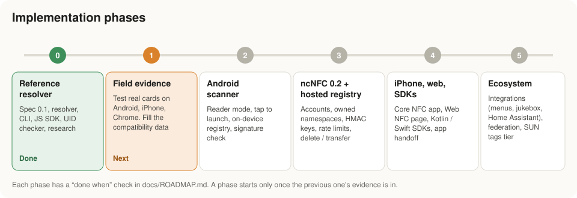

# Roadmap and implementation phases

Each phase has deliverables and a **done when** check. A phase starts only when the previous phase's evidence is in. Fact references (C1, P8, …) point to [`FACTS.md`](FACTS.md).

**Explicit non-goals, every phase:** cloning access cards, copying fares, bypassing locks, reading protected sectors, tracking people, and treating UIDs as secure.

---

## Phase 0: Reference resolver and research (done)

- [x] ncNFC 0.1 draft, JSON schemas, public object format
- [x] Namespace-aware binding with explicit `ambiguous` collisions
- [x] Read-only HTTP resolver, Open Graph landing pages, CLI, zero-dependency JS client
- [x] UID quality classifier (`src/observation.js`): random-ID and cascade-tag refusal, NUID, manufacturer codes (C1–C7)
- [x] ISO 15693 canonical byte order
- [x] Web NFC probe page (`tools/webnfc-probe.html`)
- [x] Landscape research, fact ledger, diagrams and illustrations

**Done when:** `npm test` passes in CI on Node 20 and 22. ✔

---

## Phase 1: Field evidence (next)

Goal: answer the open questions in `FACTS.md` with real cards before building apps around guesses.

**Deliverables**

- [ ] `data/compatibility/` with one JSON file per card type and device. It records technology, UID length, `uidClass`, Android tech list (especially `NdefFormatable`), stable across ≥3 taps (yes/no), Web NFC result (`reading` / `readingerror`), and iPhone detection (yes/no). **It never stores the UID itself.**
- [ ] Schema for those files plus a validator test
- [ ] Test sheet in `docs/COMPATIBILITY.md` generated from the data
- [ ] Byte-order notes for ISO 15693 per platform (C8)

**How**

- Android: NXP TagInfo (or any tag-info app) for tech lists and IDs, plus the probe page served locally over HTTPS
- iPhone: NXP TagInfo for iOS, to see which families show an identifier
- Cards: only cards you own or are allowed to reuse, such as expired transit cards, old hotel keys, event passes, blank NTAG/ICODE tags

**Done when:** at least 10 card types are tested on 2 Android phones (one non-NXP controller if possible) and 1 iPhone. P12, P13, P17 and C8 each have a recorded answer.

---

## Phase 2: Android scanner MVP

Goal: the first real NewCard app. Android first, because it is the only platform that can open on a bare-card tap (P3).

**Deliverables**

- [ ] Kotlin app, reader mode for NfcA/B/F/V in the foreground
- [ ] `ACTION_TECH_DISCOVERED` launch with a tech-list filter. For API 37+ targets the activity requires `DISPATCH_NFC_MESSAGE` (P6). Handle the Android 16 "Launch via NFC" switch via `isTagIntentAllowed()` (P5)
- [ ] Capture `{technology, uid}` plus private fingerprint `{atqa, sak}` / `{pmm}` / `{dsfid}`
- [ ] On-device registry first (works offline), then optional sync to a resolver
- [ ] Registration flow with the repeat-read check: tap, lift, tap again; refuse if the UID changed
- [ ] NXP originality-signature check for NTAG21x / Ultralight EV1 (S1); store the result as an assurance hint
- [ ] Same canonicalisation and classifier rules as `src/observation.js`, with shared test vectors

**Done when:** you can register 5 of your own cards, tap each with the app closed, and land on the right object. A random-ID card is refused at registration. The shared test vectors pass in both the JS and Kotlin code.

---

## Phase 3: ncNFC 0.2 and a hosted registry

Goal: let more than one person use it, safely.

**Protocol (spec + schemas + tests together)**

- [ ] `technology: "unknown"` at resolve time only (Web NFC, P11)
- [ ] Optional private fingerprint fields; `binding.uidClass` in responses
- [ ] Assurance tiers: `unverified` → `observed` → `signed` → `cryptographic`
- [ ] App handoff: `newcard://scan?state=…&return=…&ns=…`; the raw UID never leaves NewCard
- [ ] Conformance test vectors (JSON) any implementation can run

**Service**

- [ ] Accounts and namespace ownership (who may bind in `demo.restaurant`)
- [ ] Durable storage with keyed HMAC of UIDs (no plaintext UID at rest)
- [ ] Rate limiting and enumeration protection on `/v1/resolve`
- [ ] Claim, transfer, delete; data retention and a privacy policy
- [ ] TLS deployment on a host chosen at that point

**Done when:** a security review is written up in `docs/SECURITY.md`, conformance vectors pass, and a second person can register cards in their own namespace without touching yours.

---

## Phase 4: iPhone, web, SDKs

- [ ] iOS app: Core NFC tag session (ISO 14443, 15693, FeliCa), started from a button, widget or Control Center control (P14, P18)
- [ ] Clear in-app message for unsupported cards (MIFARE Classic, P17)
- [ ] Web scanner page for Android Chrome, limited to tags Phase 1 showed work (P8, P9)
- [ ] Kotlin and Swift SDKs; JS SDK gains the handoff helper
- [ ] Universal links / app links for `/o/nc_…`

**Done when:** the same card resolves to the same object from the Android app, the iPhone app (where the card is supported), Chrome, and a USB reader.

---

## Phase 5: Ecosystem

- [ ] Reference integrations: restaurant menu, Phoniebox-style jukebox (A2), Home Assistant (A3)
- [ ] Federation: `/.well-known/ncnfc` advertises which namespaces a resolver serves
- [ ] Optional high-assurance tier with SUN tags (S3) for people who do buy new tags
- [ ] Explore OS-level integration only after real adoption

**Done when:** at least one integration not written by the NewCard maintainers is live.
